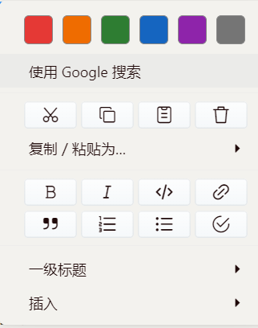

# typora-handy

**简体中文** | [English](README.en.md)

[用途](#用途) · [Windows 安装](#windows-安装) · [卸载](#卸载) · [使用范围](#使用范围) · [许可证](#许可证) · [反馈与支持](#反馈与支持)

## 用途

一个轻量的 Typora 文字上色与图片调整插件。支持原生右键菜单上色，以及图片自由拖动、四角等比例缩放，不依赖其他插件框架。

| 功能 | 操作 |
| --- | --- |
| 文字上色 | 选中文字，在原生右键菜单中选择颜色 |
| 图片移动 | 点击图片后，拖动图片或蓝色边框 |
| 图片缩放 | 拖动四角手柄，保持图片当前宽高比 |

### 文字上色

选中文字 → 右键 → 点击“使用 Google 搜索”上方的色块。

提供红、橙、绿、蓝、紫、灰六种颜色，没有悬浮按钮，也不占用快捷键。菜单会根据选区和窗口空间调整位置，尽量避开选中的文字。

上色后的内容以 HTML 标签保存在 Markdown 中，例如：

```html
<span style="color: #e53935">需要强调的文字</span>
```

效果预览：



### 图片调整

1. 在正常编辑模式中点击一张图片，显示蓝色边框和四角手柄。
2. 拖动图片或边框，可以向任意方向移动；拖动任意一个角，可以保持当前宽高比缩放。
3. 松开鼠标确认修改；拖动过程中按 `Esc` 取消本次操作，再按一次关闭边框。
4. 需要撤回已确认的修改时，可使用 Typora 的撤销操作。

自由拖动采用相对原排版位置的平移：**图片仍保留原来的占位，移动后可能覆盖其他正文**，不是重新排列段落或自动让文字环绕。其他阅读器和导出格式能否呈现相同效果，取决于对 HTML 样式的支持。代码块、HTML 代码块、源码模式和锁定文档不启用图片调整。

## Windows 安装

1. 下载或克隆本项目。

2. 完全退出 Typora。

3. 以**管理员身份**打开 PowerShell，执行对应命令（<span style="color: #e53935">注意将路径替换为本项目在本地的实际解压路径</span>）：

   **PowerShell：**

   ```powershell
   powershell -NoProfile -ExecutionPolicy Bypass -File "本仓库在你本地的解压路径\install.ps1"
   ```

   **更新插件：** 完全退出 Typora，用新版项目文件重新运行安装脚本即可。重复安装会覆盖插件文件，不会重复添加加载标签。

## 卸载

完全退出 Typora，在项目目录以管理员身份打开 PowerShell，执行：

```powershell
powershell -NoProfile -ExecutionPolicy Bypass -File .\install.ps1 -Uninstall
```

如果安装时手动指定了目录，卸载时也可以加上 `-TyporaPath "你的 Typora 安装目录"`。

卸载会移除本插件的加载标签和 JS 文件，保留备份及其他修改。文档中已有的颜色标签、图片位置和尺寸会保留。

## 使用范围

- 当前提供 Windows 安装脚本，安装和卸载需要对 Typora 安装目录有写入权限，通常需要管理员权限。
- 支持正常编辑模式中同一段落内的选区，不处理源码模式、代码块或跨段落选区。如果 Typora 在右键时自动选中了单词，也可以对该单词上色。
- 为简化右键菜单，插件会隐藏菜单中的拼写建议和字典操作，不会关闭正文的拼写检查。
- 插件直接使用 Typora 内部编辑接口，版本变化可能需要适配。Typora 升级覆盖 `window.html` 后，需要重新执行安装脚本。
- 颜色以 HTML 标签保存，其他 Markdown 阅读器能否显示颜色，取决于其对内联 HTML 和样式的支持。

## 许可证

项目代码采用 [Apache License 2.0](LICENSE) 许可证。

## 反馈与支持

欢迎提交 Issue，反馈使用问题或提出改进建议。如果这个小插件对你有帮助，也欢迎点个 Star！


